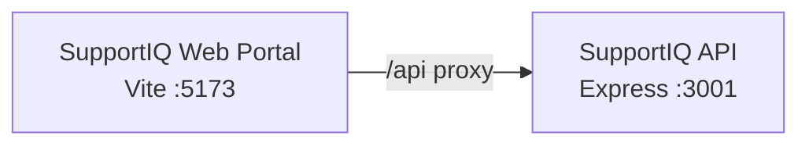

# Azure Debug Plan

> This plan is the source of truth for generating the
> VS Code debug setup in this workspace.
>
> **Status:** Implemented
> **Execution Mode:** Guided
> **Created:** 2026-11-05T08:34:38.7606636+08:00
> **Last Updated:** 2026-11-05T12:53:01.3947896+08:00

---

## Prerequisites

| Tool / Extension | Category | Service(s) | Installed | Version |
|------------------|----------|------------|-----------|---------|
| Node.js | Runtime | * | ✅ | 26.13.0 |
| npm | Package manager | * | ✅ | 11.20.0 |
| Chrome | Browser | SupportIQ Web Portal | ✅ | 156.0.8078.80 |
| `ms-vscode.js-debug` (JavaScript Debugger) | VS Code debug integration | SupportIQ Web Portal, SupportIQ API | ✅ | 1.140.0 |

No additional prerequisites are required for the current local stack. The JavaScript debugger is bundled with this VS Code installation.

---

## Debug Configurations

| Generate | Debug Config Name | Service Label | Service Root | Project Type | Runtime | Version | Azure Dependencies |
|----------|--------------------|---------------|--------------|--------------|---------|---------|---------------------|
| [x] | SupportIQ Web Portal (debug) | SupportIQ Web Portal | . | frontend-spa | node-ts | 26.13.0 | — |
| [x] | SupportIQ API (debug) | SupportIQ API | . | app-service | node-js | 26.13.0 | — |
| [x] | Debug All Services | Debug All Services | . | *Compound Config* | — | — | — |

Project Type Descriptions

| Project Type | Description |
|-------------|-------------|
| frontend-spa | React single-page application served by Vite. |
| app-service | Express HTTP API running on Node.js. |

> Vite proxies `/api` to the Express API at `http://localhost:3001`; the compound configuration should start the API before the web portal. The existing `npm run dev` also starts both processes together.

---

## Orchestrator

| Orchestrator | Container Runtime | Compose Command | Description |
|-------------|-------------------|-----------------|-------------|
| Docker Compose | Docker (not confirmed; not required for this stack) | `docker compose` (not confirmed) | No emulator containers are needed: the active API store is SQLite and attachments use local files. Docker is only the prescribed fallback if emulator services are added later. |

---

## Emulators

No emulators are planned. The runtime dependencies contain no Azure SDKs or Functions bindings; Azure resources in the project plan are future deployment targets. The API currently uses Node.js built-in SQLite at `data/supportiq.db` and local attachment storage.

---

## Architecture Diagram

During local debugging, the Vite portal forwards API requests to the Express service; neither service requires an Azure emulator.

---

## Migrations

The MariaDB migration files and `npm run db:migrate` command exist, but migration automation is intentionally unchecked: the running API still uses SQLite, and the MariaDB cutover is not approved.

| Generate | Service | Migration Tool |
|----------|---------|----------------|
| [ ] | SupportIQ API | Raw SQL (MariaDB; `server/migrations/`, `scripts/migrate.mjs`) |

---

## API Test Collections

| Generate | Service | Description |
|----------|---------|-------------|
| [x] | SupportIQ API | 37 endpoint scripts in `api-test-collections/supportiq-api/` |

Scripts are under `api-test-collections/supportiq-api/`, one `invoke.ps1` per route. See `api-test-collections/README.md` for local session-cookie and resource-ID setup.

> 🔒 = requires an authenticated session cookie (`SUPPORTIQ_COOKIE`).

### GET /api/health `http-health`
### POST /api/auth/register `http-register`
### POST /api/auth/login `http-login`
### POST /api/auth/logout `http-logout`
### POST /api/auth/logout-all 🔒 `http-logout-all`
### GET /api/auth/me `http-me`
### GET /api/tickets 🔒 `http-listTickets`
### POST /api/tickets 🔒 `http-createTicket`
### GET /api/tickets/:id 🔒 `http-getTicket`
### POST /api/tickets/:id/messages 🔒 `http-addTicketMessage`
### PATCH /api/tickets/:id/status 🔒 `http-updateTicketStatus`
### PATCH /api/tickets/:id/assign 🔒 `http-assignTicket`
### PATCH /api/tickets/:id/priority 🔒 `http-changeTicketPriority`
### POST /api/tickets/:id/rating 🔒 `http-rateTicket`
### POST /api/tickets/:id/close 🔒 `http-closeTicket`
### POST /api/tickets/:id/read 🔒 `http-readTicket`
### GET /api/canned-replies 🔒 `http-listCannedReplies`
### GET /api/bot/conversation 🔒 `http-getBotConversation`
### POST /api/bot/messages 🔒 `http-sendBotMessage`
### POST /api/bot/reset 🔒 `http-resetBotConversation`
### GET /api/bot/conversations/:id 🔒 `http-getBotConversationById`
### GET /api/admin/overview 🔒 `http-getAdminOverview`
### GET /api/admin/team 🔒 `http-getAdminTeam`
### GET /api/admin/conversations 🔒 `http-getAdminConversations`
### GET /api/admin/conversations/:id 🔒 `http-getAdminConversation`
### GET /api/admin/settings 🔒 `http-getAdminSettings`
### PUT /api/admin/settings 🔒 `http-updateAdminSettings`
### POST /api/admin/kb 🔒 `http-createKnowledgeEntry`
### PATCH /api/admin/kb/:id 🔒 `http-updateKnowledgeEntry`
### DELETE /api/admin/kb/:id 🔒 `http-deleteKnowledgeEntry`
### GET /api/admin/canned-replies 🔒 `http-getAdminCannedReplies`
### POST /api/admin/canned-replies 🔒 `http-createCannedReply`
### PATCH /api/admin/canned-replies/:id 🔒 `http-updateCannedReply`
### DELETE /api/admin/canned-replies/:id 🔒 `http-deleteCannedReply`
### POST /api/uploads 🔒 `http-uploadAttachment`
### GET /api/attachments/:id 🔒 `http-getAttachment`
### GET /api/events 🔒 `http-events`

---

## Convenience Scripts

`npm run dev` already starts the API and Vite development server; `npm test` and `npm run build` are already registered. No additional convenience scripts are needed for this local stack.

| Generate | Script | Registered In | Description |
|----------|--------|---------------|-------------|

## Debug Configuration Checklist

Debug Configuration Checklist:
✅ SupportIQ Web Portal (debug) — Vite emitted `VITE ... ready` and `Local: http://localhost:5173/`; HTTP returned 200.
✅ SupportIQ API (debug) — Node Inspector listened on 9229 and API emitted `SupportIQ API listening on http://localhost:3001`; `/api/health` returned 200.
✅ Debug All Services — API became ready before Vite; each service started once and returned HTTP 200; ports 3001, 5173, and 9229 were released after teardown.